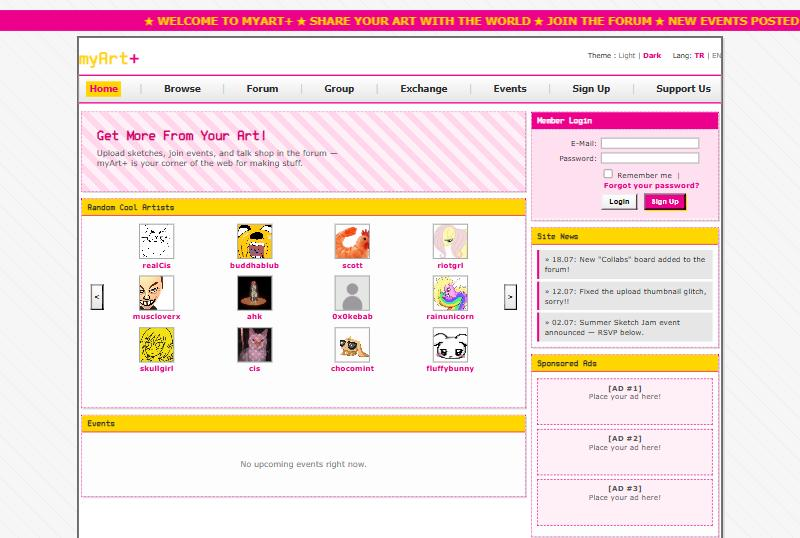
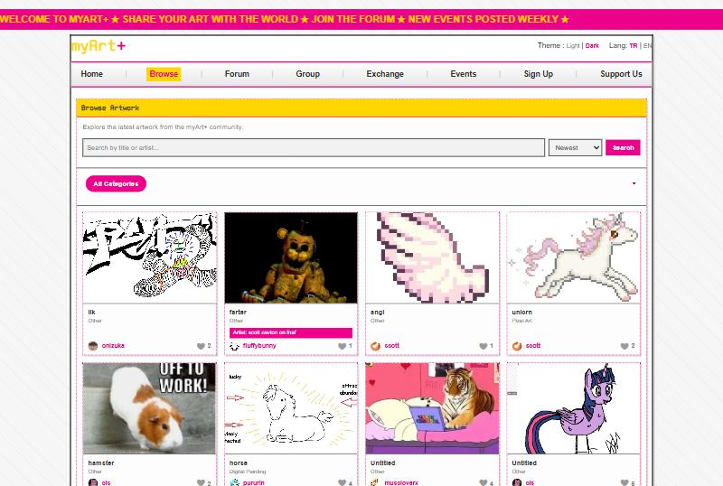
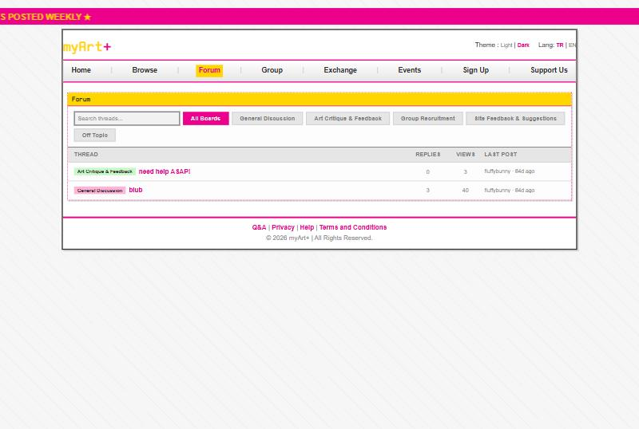

# myArt+

A retro, Y2K-styled community site for artists: share artwork, talk in forums, form groups, host events and trade commissions.

**Live site: https://myartplus.site.je**

| Home | Browse | Forum |
|---|---|---|
|  |  |  |

## What it does

- **Profiles and artwork:** upload art by category with tags (credit required for non-original work), commission status and price list, a featured/pinned piece, and a lightbox gallery with likes and comments.
- **Profile customization:** accent and highlight colours, background patterns or your own background photo (fit, position and darkening controls), font and box styles, one-click theme presets. Colours that would hurt readability are rejected automatically.
- **Follow feed:** follow artists and see their latest work on your home page, plus a getting-started checklist for new members.
- **Commission orders:** request a commission from an artist with commissions open, then track it through accepted, in progress and delivered, chat about it, and leave a rating.
- **Exchange:** a board for offering and requesting art trades. People can reply to a post, and only the author sees the replies and can open a chat with them.
- **Forum:** boards, threads, replies, pinning and locking, search.
- **Groups:** create and join groups, admin approval, group chat with file sharing.
- **Direct messages:** friend requests, one-to-one chat with attachments, unread badges.
- **Events:** event pages with posters, RSVPs and comments; past events are cleaned up automatically.
- **Moderation and admin:** report artwork, comments or users (including a stolen-art report), review and remove content, approve groups, site statistics, and database/file backup downloads.
- **Notifications:** in-app, plus optional e-mail notifications that users switch on themselves.
- **Friendly error pages:** styled 403, 404 and 500 screens and a maintenance mode, all bilingual.
- **Bilingual and themeable:** English and Turkish, light and dark theme.

## Built with

PHP 8 and MySQL (no framework), jQuery for the AJAX parts, hand-written CSS in a Y2K / early-web style. Hosted on a free shared host (InfinityFree).

## Security work

- CSRF tokens on every state-changing request, prepared statements everywhere, output escaping.
- Hardened sessions, rate limiting on login, sign-up and password reset.
- E-mail verification (HTML mail sent through Brevo's HTTPS API) and Cloudflare Turnstile captcha.
- Reports, comments and orders are rate-limited; content is escaped on output and only whitelisted values ever reach CSS.
- Uploads are type-checked, renamed to safe names, and deleted from disk when replaced or when an account is removed.
- Secrets live outside the repository.

## Source code

The code is in a private repository. If you would like to read it, say hello on my GitHub profile and I will happily add you.
